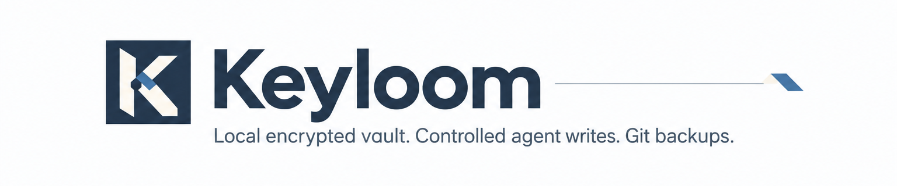

# Keyloom



A local encrypted vault with a compact Windows desktop, controlled CLI writes for coding agents, and ciphertext-only Git backups.

**Early Windows release.** MIT licensed, unsigned, and not independently audited. macOS/Linux desktop support and Secret Relay are not implemented in this release.

**0.1.4 source candidate:** the GUI, CLI, encryption, attachments, backup and updater now run in TypeScript on one shared Bun runtime. Python/PyInstaller are not used to build or run this candidate. The native CI matrix targets Windows x64, macOS Apple Silicon/Intel and Ubuntu 24.04+ x64/ARM64; those additional platforms are not released until native validation passes. The latest published 0.1.3 remains Windows-only.

[Releases](https://github.com/lubobill1990/keyloom/releases) · [中文说明](README.zh-CN.md) · [Agent installation](#installation-for-coding-agents) · [Security boundaries](docs/SECURITY.md)

## What it does

- Per-Monitor V2 DPI awareness, WebView2, custom window chrome and dense editable rows.
- One right-aligned save control: pending, saving, saved, verified, or failed. Clicking it immediately saves and reads the encrypted record back; “saved locally” never means “pushed remotely.”
- Custom fields, masked credentials, password generation, encrypted attachments, favorites, metadata search and session auto-lock.
- Open attachments in their system default application through restricted temporary directories, or explicitly export them as plaintext.
- Approve CLI metadata/write access for the current unlock session. Agents can create items, set fields, generate secrets and attach files without receiving secret values.
- Install the bundled Keyloom skill for GitHub Copilot, Claude Code and Codex without modifying plugin caches.
- Periodically push only ciphertext to a dedicated GitHub, GitLab or other SSH/HTTPS Git repository.
- When closing with unpushed changes: wait for a verified push, explicitly exit with local data only, or return to editing. Failed pushes do not silently close the app.

## Windows installation

1. Download the installer ZIP or portable `.tar.zst` from [Releases](https://github.com/lubobill1990/keyloom/releases).
2. Verify it against the release's `SHA256SUMS.txt`. Checksums detect corruption; trust in the publisher still matters.
3. For the installer ZIP, keep its setup executable, archive and metadata together. For portable use:

   ```powershell
   New-Item -ItemType Directory -Path "$env:LOCALAPPDATA\Programs\Keyloom" -Force
   tar -xf .\keyloom-0.1.3-windows-x64.tar.zst -C "$env:LOCALAPPDATA\Programs\Keyloom"
   & "$env:LOCALAPPDATA\Programs\Keyloom\Keyloom\bin\launcher.exe"
   ```

Windows needs the WebView2 Runtime. Release artifacts include the Bun runtime and the packaged Python service; end users do not need to install Bun, Python or uv.

Create a vault in an empty folder, or select an existing compatible v2 vault. Save the Secret Key recovery file separately from the vault, source repository and Git backup. Losing all authorized devices and recovery files, or forgetting the master password, makes recovery impossible.

## Installation for coding agents

The human installs and unlocks Keyloom. **Do not ask for master passwords, recovery files or API tokens in a conversation.**

An agent can download and unpack the portable release without running an interactive installer:

```powershell
$release = Invoke-RestMethod https://api.github.com/repos/lubobill1990/keyloom/releases/latest
$asset = $release.assets | Where-Object name -Match '^keyloom-.+-windows-x64\.tar\.zst$' | Select-Object -First 1
$checksum = $release.assets | Where-Object name -EQ SHA256SUMS.txt
if (-not $asset -or -not $checksum) { throw 'Expected release assets were not found.' }
$download = Join-Path $env:TEMP $asset.name
$sumsFile = Join-Path $env:TEMP 'keyloom-SHA256SUMS.txt'
Invoke-WebRequest $asset.browser_download_url -OutFile $download
Invoke-WebRequest $checksum.browser_download_url -OutFile $sumsFile
$line = Get-Content $sumsFile | Where-Object { ($_ -split '\s+')[1] -eq $asset.name }
if (@($line).Count -ne 1) { throw 'Missing or ambiguous checksum.' }
$expected = ($line -split '\s+')[0]
if ((Get-FileHash $download -Algorithm SHA256).Hash -ne $expected) { throw 'Checksum mismatch.' }
$install = Join-Path $env:LOCALAPPDATA 'Programs\Keyloom'
New-Item -ItemType Directory -Path $install -Force | Out-Null
tar -xf $download -C $install
if ($LASTEXITCODE -ne 0) { throw 'Extraction failed.' }
$keyloom = Join-Path $install 'Keyloom\Resources\app\backend\keyloom.exe'
& $keyloom agents install --all --json
```

Ask before installing/updating user-level agent configuration. The command installs only Keyloom's own skill directories:

| Host | User-level destination |
|---|---|
| GitHub Copilot | `~/.copilot/skills/keyloom/SKILL.md` |
| Claude Code | `~/.claude/skills/keyloom/SKILL.md` |
| Codex | `~/.agents/skills/keyloom/SKILL.md` |

Use `--agent copilot`, `--agent claude`, or `--agent codex` for selected hosts. Existing different skills are not overwritten unless `--overwrite` is explicitly supplied; a backup is retained. Restart the agent session after installation.

The desktop settings page also offers one-click skill installation. The installed skill records the local executable path and profile, so PATH changes are not required. Reinstall/update the skill after moving a portable installation.

### Agent write workflow

1. The human opens Keyloom, unlocks it, and enables **CLI access for this unlock session**.
2. Inspect metadata with `keyloom status --json` and `keyloom item list --json`. The CLI does not return field values.
3. Use a generated secret without learning it:

   ```powershell
   & $keyloom item generate --id <item-uuid> --field "API token" --length 32 --json
   ```

4. To create an item, pipe a local UTF-8 JSON document into `keyloom item put --stdin --json`. Required fields:

   ```json
   {
     "title": "Example service",
     "category": "Development",
     "tags": ["example"],
     "notes": "",
     "fields": [
       { "type": "text", "name": "Account", "value": "example", "secret": false }
     ]
   }
   ```

5. To set a credential from an already-authorized local pipe, use `keyloom item set --id <uuid> --field "Password" --secret --stdin --json`. Input is preserved exactly, including trailing newlines. Never put a secret in arguments or construct a tool call containing an existing secret.
6. Attach files with `keyloom item attach --id <uuid> --field "Files" --file <path> --json`.

Writes return identifiers, timestamps and counts, not secret values. Whole-item replacements require `expectedRevision` from the current metadata listing; stale desktop writes are rejected using encrypted-file revisions, including updates made in the same second. Locking or beginning to close revokes CLI access. Cancelling exit does not reapprove it.

New desktop items receive an editable default title so credentials can autosave immediately. Explicitly invalid drafts remain visibly unsaved; automatic locking clears invalid unsaved drafts rather than retaining decrypted form contents. Agent activity does not extend the human unlock timeout.

For a human-operated headless session, `keyloom daemon --vault <folder>` prompts for the master password in a terminal and starts the same controlled local broker. It refuses to request a master password from non-interactive agents.

## Encrypted Git backups

Configure the remote, branch and interval in Settings. Use a **dedicated, initially empty repository**, preferably private. Authentication uses an existing OpenSSH agent or system Git credential manager. Embedded URL credentials and the Keyloom source repository are rejected.

Only these paths are eligible:

```text
vault.json
records/<uuid>.enc.json
attachments/<uuid>.enc
.gitattributes  # fixed, secret-free byte-preservation policy
```

Keyloom validates ciphertext envelopes and snapshots them under the vault transaction lock. It commits in an app-owned mirror, not the vault's parent Git repository, verifies that staged Git blobs exactly match snapshot bytes, then checks the remote's commit acknowledgement. A fixed `.gitattributes` disables text conversion, filters and encoding transformations, including during normal restore clones. Recovery files, device keys, previews, exports, logs, settings and unrelated company-repository history are never staged. Git-host size limits still apply; automatic LFS conversion is intentionally disabled.

This is **push-only backup**, not automatic multi-device merge. Remote divergence stops the push without force-pushing. To restore, clone the ciphertext repository, open its folder in Keyloom, and supply the separately held recovery file and master password. A new backup profile must use a fresh empty remote; adopting nonempty remotes and automatic conflict merges are intentionally not supported yet.

Git history retains old ciphertext. Rotating keys does not retroactively revoke copies protected by old keys. File counts, sizes and commit timing remain visible to the Git host.

## Development

Git and Bun 1.3.11 are required. Windows packaging also needs Visual Studio C++ Build Tools for a tiny argument/stdio launcher; macOS/Linux use a shell launcher. Neither launcher implements encryption or bundles another runtime.

```powershell
bun install --frozen-lockfile
bun run typecheck
bun run test
bun run build
bun run start
```

`bun run build:release` creates an installer and an extracted portable app. `scripts/post-build.ts` inserts the DPI bootstrap into the Electrobun launcher **before** its native event loop starts; applying a CSS zoom is not the DPI fix. The pinned SDK patch also sizes the initial Windows WebView from `GetClientRect`, not the outer window frame; a user resize must not be required to expose the rightmost controls. Packaging fails if that patch is missing from the compiled application. If a stale local SDK cache triggers this check, remove only `node_modules/electrobun` and reinstall with `bun install --frozen-lockfile`.

Desktop shortcuts: `Ctrl+K` / `Ctrl+F` search, `Ctrl+S` save and verify, `Ctrl+L` lock, and `Ctrl+N` create. A capture-phase handler intercepts browser download shortcuts such as `Ctrl+J` before focused controls can swallow the event. Other browser-only shortcuts are also prevented when WebView2 delivers them to the page; host-level accelerators, notably F5/F12, can bypass page handlers and are not guaranteed disabled. Normal typing, copy/paste, undo/redo and word-navigation shortcuts remain available.

The native TypeScript v2 encryption core is shared by the GUI and CLI. It uses Bun's `node:crypto` implementation of scrypt, HKDF-SHA256, AES-256-GCM and Ed25519, not custom cryptographic algorithms. Existing encrypted records, attachments, recovery files and Windows DPAPI device keys retain their formats/locations. macOS uses Keychain; Linux requires Secret Service/libsecret, with no plaintext fallback. Python sources under `backend/` and `tests/reference/` are retained only as an independent development oracle; normal tests, builds and release signing do not invoke them.

If a previous Python release has an interrupted migration/key-rotation transaction, finish recovery with 0.1.3 first. The new implementation refuses to overwrite an unrecognized old transaction journal. Secrets are not stored in browser localStorage or application logs. CLI IPC uses authenticated AES-GCM envelopes over IPv4 loopback, OS-protected transport keys, freshness/replay checks and a restricted write-only method surface. Linux needs GTK/WebKitGTK, X11/XWayland, Secret Service, zenity and system Git. Initial macOS builds are unsigned/not notarized; use normal OS approval, never disable Gatekeeper.

Optional independent interop check: `bun tests/reference/roundtrip.ts` uses uv/Python **only as a development oracle**, verifies that Python opens JS-written vaults/attachments after password changes and rotation, and that JS reads Python-written updates. It is not part of normal builds or CI.

## Automatic updates

Starting with **0.1.3**, packaged Windows builds check this repository's GitHub Releases after 15 seconds and every six hours, and download a newer stable version in the background. Click the version in the title bar for status, a manual check, the automatic-check preference, the update log, or an available rollback. **Restart to update is always an explicit user action**; there is no timed restart.

The fixed `releases/latest/download/latest.json` feed carries an Ed25519-signed manifest binding the repository URL, stable version, platform, filename, size and SHA-256 digest. The public key is pinned in the app. A separate read-only CI signing job receives the release key; the build job never does, and only the publisher has release-write permissions. Unsigned, modified, older and same-version network packages are rejected.

Restart uses the same local-save, temporary-file and Git-backup checks as normal exit. Cancelling leaves the app open; a failed save never starts installation, and an update cannot discard an unsaved draft. An external copy of the packaged CLI waits for **only this installation's desktop, service and launcher PIDs**, verifies the package again, safely extracts it, preserves the old application, and swaps the program directory. It confirms both the new UI and service report healthy; a failed start or health check restores and restarts the previous application.

Vaults, recovery files, settings, WebView data and ciphertext mirrors are not program-update payloads. Updating refuses nested data/settings folders, links/junctions, unexpected program files and unsafe archive paths. Keep personal files outside the program directory. The latest known-good program backup is retained beside the install for explicit rollback. Update preferences, progress results and logs live under the application state's `updates` folder; a failed update is reported rather than silently marked successful. Local antivirus or filesystem restrictions are not bypassed; use the release page for a manual install if a helper cannot run.

**Bootstrap:** versions up to 0.1.2 have no updater. Install 0.1.3 or later manually once; existing v2 vaults remain compatible. For portable upgrades, use a fresh program directory, or rename the old program directory and extract at its previous location. Do not overlay old archives: stale assets deliberately fail the inventory check. Never remove your separate vault/recovery folders. Development builds do not check automatically or install updates.

Release maintainers: retain the existing independent signing key and its encrypted backup; do not generate a replacement during the TypeScript migration. `bun run release:assets` creates native update archives and unsigned metadata. The separate signing job invokes `scripts/update-release.ts`, verifies all five platform archives, and accepts only `KEYLOOM_UPDATE_SIGNING_KEY` matching the pinned public key. No Python or separate crypto executable is involved.

CI checks source-publication boundaries, strict TypeScript, unit/integration tests and five native packages, including a real UI/backend health handshake and write-only CLI exercise. A matching `v*` tag publishes only after all platform jobs and feed signing pass. Windows Authenticode signing is not configured; signed update manifests use the independent Ed25519 key described above.
