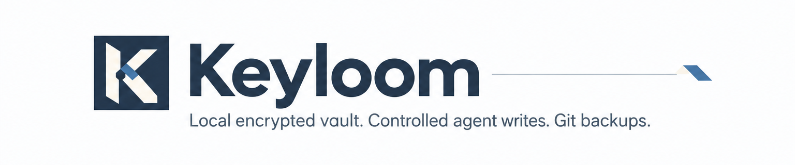

# Keyloom

面向人和编程 Agent 的本地加密密库。支持 Windows、macOS 和 Linux，MIT 开源。

> 当前是未做独立安全审计、未签名的早期版本。请先使用测试数据验证自己的备份和恢复流程。

**从 0.1.4 起**，GUI、CLI、加解密、附件、Git 备份和更新器均改为 TypeScript，共用已有 Bun 运行时。构建和运行不再依赖 Python/PyInstaller，也不打包第二份 CLI 运行时。覆盖 Windows x64、macOS Apple Silicon/Intel、Ubuntu 24.04+ x64/ARM64；五个平台都须通过真实界面启动、系统密钥存储和 CLI 写入验证才能发布。0.1.3 及以前仍是旧 Windows 版本。

沿用现有 scrypt、HKDF-SHA256、AES-256-GCM 加密格式和恢复文件，Windows 继续读取原 DPAPI 设备密钥；macOS 使用钥匙串，Linux 使用 Secret Service，不会降级为明文密钥文件。旧版若存在未完成的迁移或换密钥事务，需先用 0.1.3 恢复；新版会明确阻止覆盖旧事务。

- 高清屏：原生窗口线程启动前启用 Per-Monitor V2；不依赖系统位图拉伸。
- 自绘紧凑标题栏，保留拖拽、缩放、最小化、最大化和关闭。
- 初次显示按真实客户区初始化内容尺寸，无需手动缩放窗口才能看全右侧按钮。
- 右侧只有一个保存状态控件：待保存、保存中、本机已保存、已核验、失败重试。点击会立即保存并回读核验；它不冒充远端备份状态。
- 敏感字段遮盖、密码生成、收藏、搜索、自定义字段和加密附件。
- 附件经确认后用系统默认应用打开；临时目录受限，锁定/退出时清理，外部编辑不会自动写回。
- CLI 仅在用户批准的解锁会话内读取记录索引和写入。生成密码只返回回执，不返回密码。
- 一键给 Copilot、Claude Code、Codex 安装产品自带 Skill，不改插件缓存。
- 应用管理独立密文 Git 镜像，定时推送 GitHub/GitLab 等 SSH/HTTPS 仓库，不会误推密库所在的公司总仓库。
- 退出前若尚未推送，可选择同步成功再退出、只保存在本机退出，或返回编辑。失败不会被当成已同步。

## 安装与 Agent 指南

见 [英文 README 的可执行安装流程](README.md#installation-for-coding-agents) 和 [Releases](https://github.com/lubobill1990/keyloom/releases)。

Windows 安装包 ZIP 内的安装器、压缩数据和元数据必须放在一起。portable 归档解压后运行 `Keyloom/bin/launcher.exe`；CLI 位于 `Keyloom/bin/keyloom.exe`，旧版 backend 路径保留兼容启动器。无须另装 Python、Bun、uv，但需要 Windows WebView2 Runtime。

macOS 选择 Apple Silicon 的 `macos-arm64` 或 Intel 的 `macos-x64`，从 DMG 将应用复制到 Applications，使用系统正常许可流程打开，不要关闭 Gatekeeper；需要已解锁的钥匙串。Linux 选择对应 x64/ARM64 归档，需 GTK 3、WebKitGTK 4.1、X11/XWayland、Secret Service/libsecret、zenity 和系统 Git。各平台具体路径和安装方式见 [安装指南](README.md#macos-and-linux-installation)。

创建密库时必须将恢复文件保存在密库之外，另行离线保管。密库、恢复文件、元密码三者不是互相替代的备份。

## 快捷键

`Ctrl+K` / `Ctrl+F` 搜索，`Ctrl+S` 保存并回读核验，`Ctrl+L` 锁定，`Ctrl+N` 新建记录。捕获阶段的处理器会优先拦截 `Ctrl+J` 等浏览器下载快捷键，不受输入控件阻止冒泡影响。其他浏览器专用快捷键在传入页面时也会被拦截，但 F5/F12 等宿主级快捷键可能绕过页面处理，当前不保证禁用；正常输入、复制粘贴、撤销重做及按词移动不受影响。

## Git 备份边界

首次绑定使用空的专用仓库，建议设为 private。只上传 `vault.json`、UUID 命名的记录密文、附件密文，以及固定无秘密的 `.gitattributes` 字节保护声明。该声明禁止 Git 换行和过滤器转换，并逐项验证实际入库字节，避免密文在备份/恢复时损坏。恢复密钥、设备密钥、明文预览、导出文件、设置和其他目录都不上传。Git 主机的文件大小配额仍然适用。

本版本是定期推送备份，不是双向自动同步。远端分叉时停止，不强推、不自动合并。恢复可先手动 clone 密文仓库，再由用户在 Keyloom 中输入元密码和恢复文件。新备份配置暂不接管非空远端。

## 自动更新

从 **0.1.3** 起，正式版在启动 15 秒后、此后每 6 小时检查本项目的 GitHub Releases，后台下载较新的稳定版并验证内置公钥签名。点击标题栏版本号可检查更新、关闭自动检查、查看日志或恢复已保留的上一版本。

- **不会自行重启**：下载就绪后，只有点击“重启更新”才开始。使用与正常退出相同的保存、临时附件清理和 Git 备份流程；保存失败不安装，取消则返回编辑，不能借更新放弃未保存内容。
- 更新清单的 Ed25519 签名绑定仓库、版本、平台、文件名、大小和 SHA-256；安装前再次验证，不接收未签名、被修改或降级的网络安装包。
- 独立更新程序只等待本安装实例的精确 PID 退出，先保留旧程序，再替换程序目录。新版本必须报告界面和后端已正常启动，否则自动恢复旧程序并重新打开。
- 密库、恢复文件、设置和 Git 密文镜像不参与替换。程序与数据目录嵌套、程序目录夹有个人文件、路径是链接或压缩包不安全时拒绝覆盖。请把个人文件放在程序目录外。
- 更新结果与日志保存在应用状态目录的 `updates` 文件夹；失败会明确显示。不会绕过杀毒软件或文件权限限制，无法运行更新程序时可从发布页手动安装。

**0.1.2 及更旧版本需先手动安装一次 0.1.3 或更新版本**，之后才具有自动更新能力。便携版请解压到新的空程序目录，或先重命名保留旧程序目录，再在原位置全新解压；不要覆盖叠加旧归档，否则遗留资源会被清单检查拦截。不要删除独立的密库和恢复文件目录。现有 v2 密库继续兼容；开发构建不自动检查或安装。

## CLI 与 Secret Relay

CLI 密码输入走 stdin 或由密库内部生成，不放在命令行参数中；stdin 本身不意味着对模型不可见，因此 Agent 也不能把已有密码写进工具调用。锁定或开始关闭即撤销 CLI 授权，取消退出不会自动恢复授权。

Secret Relay 只预留扩展边界，本版本没有取密或注入接口。后续适合作为默认关闭、单次授权、短 TTL、限定目标的独立能力，共用加密存储和授权，而不是向 Agent 暴露任意明文读取。

[安全与威胁边界](docs/SECURITY.md) · [Relay 扩展设计](docs/RELAY.md)
